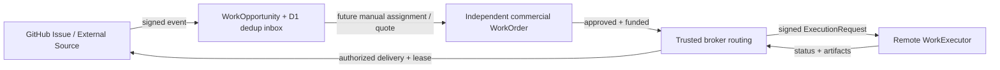

# Plug-in Work Adapters — buildable v0.1

This work is **a genuine typed SDK, a real GitHub App authentication/webhook adapter, and a runnable signed remote executor example**, not a production agent marketplace. The adapter roles are intentionally decoupled from pricing, payments and authorization. Project references below are on draft PR branches, not deployed services.

## The business boundary

`WorkOpportunity` is an **uncommitted** statement from a verified upstream event. It has no price, buyer approval, payment status or executor permission. Do not pass it to the current `Commerce.start` as if it were a WorkOrder.

A commercial `WorkOrder` requires a separately authorized offering, quote, buyer consent, funding rules and policy checks. It exists independently of any MCP Tasks/A2A task handles.

A `WorkExecutor` receives a minimized, versioned `ExecutionRequest` derived from an authorized WorkOrder by a trusted broker. It does **not** receive raw Stripe tokens or unrestricted customer credentials.



**Current integration reaches the inbox and the remote execution wire protocol separately. It does not automatically connect a GitHub issue to a funded gig or run arbitrary remote code.**

## Packages

| Package | Responsibilities |
|---|---|
| `@awc/adapter-sdk` | Effect-first `WorkSource`, `WorkExecutor`, typed manifests, opportunities, execution requests/snapshots, delivery contract, registry Layer, conformance checks |
| `@awc/adapter-remote-http` | HTTPS allowlisted remote worker client, signed canonical requests, bounded responses, `start/inspect/recover/cancel` |
| `@awc/adapter-github` | GitHub App signed `issues` webhook intake, allowlisted installation/repository, issue reconciliation and authorized result comments |
| `@awc/source-inbox` | Durable signed-event dedup and buyer-scoped, uncommitted opportunities (D1), in-memory fixture |
| `examples/remote-executor` | Cloudflare Worker + D1 example speaking the exact remote executor wire protocol |

`packages/runtime` retains its original `WorkProvider` and synchronous `Worker` interfaces for older code. **Do not mass-rename them until commerce and worker routing are migrated.** The new SDK is the future-facing plugin contract.

## 1. Register a trusted in-process executor

```ts
import { Effect } from "effect";
import { registryLayer } from "@awc/adapter-sdk";
import { createRemoteHttpExecutor } from "@awc/adapter-remote-http";

// Values are administrator-provisioned from secrets, NOT agent input.
const executor=createRemoteHttpExecutor({
  id:"organization.sample-worker",
  baseUrl:"https://remote.example",
  allowedHost:"remote.example",
  sharedKey: env.REMOTE_WORKER_SHARED_KEY,
  supportedTaskTypes:["task:example"],
});
const registry=registryLayer([], [executor]);
```

The registry rejects duplicate adapter IDs and wrong roles. A manifest is **not sufficient evidence** that an arbitrary remote seller is legitimate: platform administrator must verify origin, privileges and supported task mappings. Remote URLs must be explicitly allowlisted in configuration; no SSRF-prone `fetch` of a URL obtained from a prompt.

## 2. Remote HTTP execution protocol

`POST /v1/executions`: accept exactly one `awc.execution/v1` JSON request, return `{"schemaVersion":"awc.executor/v1","handle":{...}}` with HTTP 202. Same `idempotencyKey` and identical payload must always map to the same `providerExecutionId`. Same key with modified payload must return 409.

`GET /v1/executions/by-idempotency/{key}`: recover accepted execution after a lost POST response; 404 only if the provider has not accepted that key.

`GET /v1/executions/{providerExecutionId}`: return `{"schemaVersion":"awc.executor/v1","snapshot":{...}}` with status, progress and optional validated WorkResult.

`POST /v1/executions/{providerExecutionId}/cancel`: return a cooperative cancellation decision. Cancelling an execution does not void a commercial contract.

All methods use configured HTTPS origin with redirects disabled and an HMAC-SHA256 signing profile bound to method, URL pathname, millisecond timestamp, idempotency key, SHA-256 of the **exact body bytes**:

```text
X-AWC-Timestamp: <milliseconds since epoch>
X-AWC-Idempotency-Key: <stable key>
X-AWC-Signature: <lowercase hex HMAC-SHA256>
```

Signed input is concatenated with newline separators. The server validates a 5-minute maximum clock difference. Production must combine with an independently authenticated broker identity, key rotation, replay/idempotency storage, egress controls and provider installation authorization. **Do not derive a financial commitment from the signature alone.**

The adapter reports `outcome_unknown` after ambiguous POST timeouts or 5xx. The broker must call `recover` and must **not** blindly start a second execution. Snapshots and artifacts remain subject to broker schema and contract verification.

### Run the reference Cloudflare remote executor

```sh
pnpm install --no-frozen-lockfile
pnpm --filter @awc/example-remote-executor exec wrangler d1 create awc-executor-example
# Copy the resulting D1 UUID to examples/remote-executor/wrangler.jsonc.
cd examples/remote-executor
pnpm exec wrangler d1 migrations apply awc-executor-example --local
# Create a unique 32+-character AWC_SHARED_KEY in .dev.vars, do not commit it:
# ENABLE_EXAMPLE_EXECUTOR=true
# AWC_SHARED_KEY=...
pnpm dev
```

The reference server responds to signed requests, persists idempotent accepted jobs in D1 and emits **synthetic public-data-only** JSON results. It does not invoke an LLM, deploy code or spend real money. The integration tests exercise the exact HTTP wire protocol with an in-process Worker handler, so they don't require Cloudflare credentials.

## 3. GitHub App WorkSource (real inbound integration)

Create a GitHub App and give it the **Issues** webhook event. Minimum required permission for webhook ingestion is Issues: read. Issue comment delivery requires Issues: write. Install only in repositories that agree to be enrolled. Record GitHub numeric repository and installation IDs, not just names.

GitHub signs the entire raw request body with `X-Hub-Signature-256`. Verify before parsing or trusting `installation` or `repository` claims. GitHub `X-GitHub-Delivery` IDs remain stable across manual redelivery, so the D1 inbox uses them to prevent replay. Do not consider a signed event an assignment approval. See https://docs.github.com/en/webhooks/using-webhooks/validating-webhook-deliveries and https://docs.github.com/en/webhooks/using-webhooks/best-practices-for-using-webhooks.

The source accepts only `issues` with action `labeled` or `opened` and the explicit `agent-work` label. It excludes pull requests masquerading as issues, ignores unrelated events, and requires an allowlisted numeric installation ID + repo ID + full name. The output is `WorkOpportunity`.

### Enable actual inbound ingestion on the AWC Worker

1. Apply `apps/server/migrations/0003_source_inbox.sql` to the already-provisioned `awc-catalog` D1 database.
2. Set `ENABLE_GITHUB_SOURCE=true` in the reviewed Worker configuration.
3. Add Worker secret `GITHUB_WEBHOOK_SECRET` (32+ random characters, matching the GitHub App webhook configuration).
4. Configure `GITHUB_SOURCE_REPOSITORIES` as a reviewed JSON array, e.g. `[{"repositoryId":123,"fullName":"example/repo","installationId":987}]`.
5. Configure `GITHUB_SOURCE_BUYER_ID` as the trusted buyer identity that owns these repositories. **It is never accepted from the webhook request.**
6. Set the App's webhook URL to `https://<our-approved-host>/integrations/github/webhook`.
7. Add the `agent-work` label to an Issue in an allowed repository; its signed event becomes a buyer-scoped Opportunity.
8. Authenticated MCP buyers with `work:read` can use `work.opportunities.list`.

No GitHub event creates a payment, quote, accepted WorkOrder, or external Worker execution. A later human-assignment step will map opportunities to trusted offerings and commerce contracts.

### Outbound GitHub issue comment delivery

The `createGitHubAppCredentials` adapter signs a short-lived RS256 App JWT, requests a GitHub installation token constrained to the **exact numeric repo ID** and `issues:write`, and caches it only until near expiry. This handles the evolving GitHub installation token formats without assuming a fixed token length. See https://docs.github.com/en/rest/apps/apps.

`WorkSource.deliver` is optional to wire: it requires an injected broker `authorizeDelivery` check and an external **single-writer durable delivery lease**. It scans existing comments for a stable digest marker before posting, so retries after uncertain responses can reconcile. This is NOT a globally atomic exactly-once comment guarantee: an uncoordinated pair of concurrent writers can still produce duplicates, and scan saturation fails closed. The public webhook ingress does not enable the outbound client automatically.

## 4. Conformance and tested examples

```sh
pnpm --filter @awc/adapter-sdk test
pnpm --filter @awc/adapter-remote-http test
pnpm --filter @awc/adapter-github test
pnpm --filter @awc/source-inbox test
pnpm --filter @awc/example-remote-executor test
pnpm typecheck
pnpm --filter @awc/server bundle
pnpm --filter @awc/example-remote-executor bundle
```

`probeExecutor` verifies stable start idempotency, recovery by original idempotency key, and snapshot contract binding. Only run probes against explicitly disposable/test executors to avoid duplicate financial side effects.

## Pending production-grade requirements

- Formal provider registry ownership verification, signed manifest/provenance checks, typed domain-specific input/output schema references, task taxonomy mappings and billing isolation.
- Trusted contract-to-executor selection and grants; commerce currently routes a **synthetic** Worker and must not be pointed at arbitrary plugin URL.
- OAuth browser login/PKCE and per-repo verified tenant mapping, rather than an administrator-configured single buyer mapping.
- Provider availability and signed status checks, queue/outbox and durable delivery leases, artifact gateway/R2 with hashes and access controls.
- GitHub outbound issue comment app credentials installed and permissioned, GitHub webhook manual redelivery/reconciliation procedure and E2E installation tests.
- Remote executor long-running task heartbeat, cancellation, externally observed effects and resolution of uncertain outcomes. No live x402/Stripe payments in this integration.
- Privacy retention/deletion and Attest receipts (`gmackie/attest#9`) with independent issuer scope and current status.

**Trust rule:** GitHub label => opportunity; human/policy + quote + funding => WorkOrder; broker-signed bounded invocation => execution; validated output => delivery; independent evidence => Attest claim.
