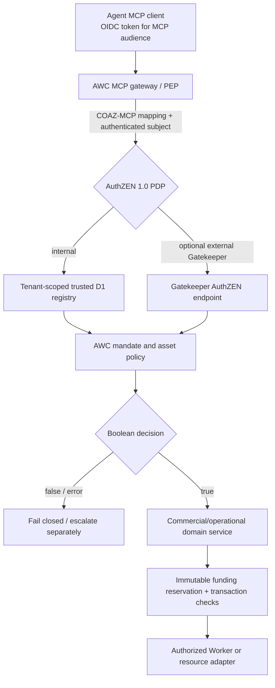

# AuthZEN as the AWC / Gatekeeper authorization boundary

**Status:** implemented alpha reference on `feat/authzen-trusted-pdp-and-gatekeeper`, not activated in production.  
**Target protocol:** OpenID AuthZEN Authorization API 1.0 (Final January 12, 2026).  
**Transport extensions:** COAZ-MCP remains a draft and is implemented only for a reviewed `tools/call` subset.

## Architecture



A `decision:true` for a tool allows invoking the **domain service**; it never grants unconditional access to arbitrary work IDs or a license to spend. The domain service must still verify tenant/buyer ownership, contract terms, approved funds, resources, current policy and idempotence.

### AuthZEN semantic bridge

- **Unconditional read/plan**: `evaluateAction -> permit` maps to `{"decision":true}`.
- **Denied or escalated action**: maps to `{"decision":false}`, with AWC-specific diagnostic `context`.
- **Conditional purchase or operational action**: defaults to `false`. A trusted `ConditionalAuthorizationVerifier` may turn it into `true` only when all independently required conditions are already satisfied and its authority is bound to the exact actor, entity, action, proposal revision and short expiry.
- Final PEP/execution gateway MUST recheck before committing, consume one-time authority idempotently and reconcile external effects. AuthZEN does not itself reserve cash, emit a legal signature, or prove a third-party settlement.

## New implementation packages

| Package | Role |
| --- | --- |
| `@awc/mandate-registry` | Read-only D1 trust graph, exact proposal validation, owner permissions, current asset state, approvals and tenant-scoped MCP reviewed policy |
| `@awc/pdp-auth` | Cryptographically verifies PDP-audience OIDC JWTs, client IDs, scopes and tenant, independent from MCP/human sessions |
| `@awc/authzen-client` | Gatekeeper/remote PDP HTTP adapter with pinned, deployment-controlled HTTPS origin and fail-closed timeouts |
| `@awc/authzen-finance` | Exact reserved economic commitment as one component of the authenticated conditional authorization |
| `@awc/economics-durable` | SQLite transactionSync treasury, integer-minor funds, reservations, idempotent captures/releases and nested mandate attenuation |
| `apps/server/src/treasury.ts` | Private SQLite-backed Durable Object class with no public mutation RPC |
| `apps/server/migrations/0003_trusted_mandates.sql` | Tenant-scoped proposals, mandate chain, owner grants, asset/telemetry state, action descriptors and authenticated approvals |
| `apps/server/migrations/0004_authzen_tool_policies.sql` | Tenant/client/tool-specific PEP authorization records |

The source registry has **no public write API**. Production mandate issuance needs a separate service that verifies issuer signatures and administrator authorization before updating these tables. Until then, the production PDP returns denial for unregistered subjects/proposals.

## Local demo

The previously working localhost-only AuthZEN demo remains available with `ENABLE_LOCAL_SANDBOX=true`. It uses strictly fictional vending/cloud/plant proposals and is not a production authorization server.

```sh
corepack enable
pnpm install --no-frozen-lockfile
pnpm typecheck
pnpm test
pnpm standards:demo
pnpm --filter @awc/server bundle
```

### Dedicated PDP service: opt-in deployment configuration

For a dedicated HTTPS PDP Worker (not merely enabling the sandbox), configure:

```dotenv
ENABLE_AUTHZEN_PDP=true
AUTHZEN_PUBLIC_ORIGIN=https://pdp.example.com
AUTHZEN_PDP_ISSUER=https://issuer.example.com
AUTHZEN_PDP_AUDIENCE=https://pdp.example.com
AUTHZEN_PDP_JWKS_URL=https://issuer.example.com/jwks
AUTHZEN_PDP_CLIENT_IDS=awc-trusted-pep
```

This requires **real signed OAuth access tokens** with the dedicated PDP audience, scope `awc:pdp:evaluate`, trusted `awc_tenant_id`, `sub`, and a registered `azp`/`client_id`. Browser passwords and agent tokens are rejected. Secrets/configuration must live in deployment configuration, not source control.

Endpoints:

- `GET /.well-known/authzen-configuration`: public metadata when explicitly enabled and host/origin matches.
- `POST /access/v1/evaluation`: authenticated request with the final AuthZEN `subject/action/resource/context` format; no model-supplied tenant or policy records accepted.
- An `awc_proposal_id` plus `awc_proposal_revision` reference a previously registered, trusted proposal. The server re-reads the parent mandate chain, revocation, current observation, owner grants and site/tenant action descriptors.

Only a properly authenticated **self-subject** PDP request is currently allowed, to prevent arbitrary cross-tenant introspection. A multi-principal service PEP acting for other parties will need separate verified actor delegation and an AuthZEN Access Request/Actor profile.

### MCP Gatekeeper policy

For existing MCP buyer sessions, register reviewed policy rows in `awc_trusted_mcp_tool_policies` for exact tenant, verified `client_id`, tool name and minimum OAuth scope. Missing records deny.

The MCP handler calls AuthZEN policy admission before every private `quotes.request`, `work.prepare`, `work.get`, `billing.options`, `billing.checkout`, `billing.reconcile`, `work.start`, and private work-order resource read.

When a remote PDP is preferred, configure the **independent upstream** values:

```dotenv
GATEKEEPER_AUTHZEN_ORIGIN=https://gatekeeper.example.com
# Stored as secret:
GATEKEEPER_PDP_SERVICE_TOKEN=<dedicated-pep-credential>
```

AWC sends the vetted COAZ-MCP `tools/call` request with validated subject, client and tenant context. The upstream PDP is authoritative; a network or signature error denies the tool. This adapter does not issue the service token or replace Gatekeeper's own policy backend.

The existing one-buyer sandbox flow uses `legacy-sandbox` mode only on localhost with `ENABLE_LOCAL_SANDBOX=true`.

## Durable economic authority

One `AWCEconomicAccount` Durable Object represents one account and **all descendants** under a single mandate root. It holds SQLite rows for:

- Zero-balance account initialization and settlement-reference idempotency.
- Root/child grant issuance with strict inherited attenuation.
- Child-allowance reservation (sibling grants cannot exceed parent).
- Spending reservations, actual captured amount, release, revocation and child wind-down.
- Append-only journal entries for events.

The ledger uses BigInt for integer minor units. Its test suite runs against Node's **real SQLite engine**, with `BEGIN IMMEDIATE` transactional atomicity. Cloudflare's production equivalent uses SQLite-backed Durable Objects and `transactionSync`. No bearer credentials, wallet keys or real settlement verification are embedded in the ledger.

**No public mutation methods are exposed on the Durable Object**. The `recordVerifiedFunding` ledger method is an internal, trusted-treasury port and assumes an independently authenticated and finalized upstream payment; never call it from an MCP request or model.

## Companion Gatekeeper implementation

The upstream AuthZEN facade is in [Gatekeeper draft PR #27](https://github.com/gmackie/gatekeeper/pull/27), separate from AWC's [draft PR #12](https://github.com/gmackie/agent-work-catalog/pull/12).

Gatekeeper reuses its **existing OPA/PIP release runtime** and verifies a distinct PDP-audience OIDC token. The first Gatekeeper profile supports only **authenticated self-subject** decisions against reviewed canonical Gatekeeper actions and authoritative resource IDs.

**The generic AWC remote tool-admission client and this first Gatekeeper facade are not automatically interoperable yet.** AWC currently projects COAZ-MCP `tools/call` for an arbitrary authenticated agent subject, while Gatekeeper requires the requested `subject.id` to equal the actual issuer-qualified subject of the PDP caller token and requires a canonical reviewed Gatekeeper action key.

There is deliberately **no authorized impersonation** by a generic service credential. To make remote multi-principal MCP PEP calls work, implement a reviewed tool-name/argument-to-resource mapping and verifiable delegated actor identity (RFC 8693 or corresponding verified AuthZEN Actor profile). Until both requirements are satisfied, the Gatekeeper PDP will reject unsupported tool actions and mismatched subjects.

Never make Gatekeeper accept a caller-provided agent ID in order to "fix" this mismatch.

## Security tests

- Correct PDP issuer/audience/algorithm, dedicated client allowlist, expiry and `awc_tenant_id`; unauthenticated and mismatched tokens fail.
- Tenant isolation for D1 proposal and mandate lookup; incomplete/corrupt ancestry and forged owner permissions deny.
- Private MCP tool and resource reads denied when PDP unavailable, caller unauthorized or policy row missing.
- No arbitrary tool clients/role mutation, no silent fallback from remote Gatekeeper to local.
- A conditional commercial action denied without trusted exact revision and reservation evidence, or after charge/release/revocation.
- SQLite transactions reject double-spend, oversubscribed child allowances, duplicate settlement references, wrong amounts and attempted balance creation.
- Every public money and equipment action remains disabled in the implementation.

## Production release blockers

1. A registered issuer/admin provisioning service with cryptographic signature verification, immutable revisions, revocation and approval workflows for mandates, owner grants and policy records.
2. Dedicated PDP OAuth client credentials, scopes and resource indicators, aud/tenant enforcement and explicit actor-chain policy based on OAuth Token Exchange.
3. Durable issuer/admin audit and per-action decision log; real D1/DO deployment and migration tests; consistency strategy for decision/commit races.
4. A treasury trust service verifying card/x402 settlement, refunds, chargebacks and provider billing liabilities before ledger credit or capture.
5. Single-use action commitment tokens/transaction fencing, resource/lease idempotency, reliable external work provider outcomes and compensation.
6. AuthZEN Access Request/Approval and complete COAZ-MCP CEL binding while those specifications mature.
7. Performance, per-tenant privacy/rate limits, operational monitoring, SOC/compliance review, real OAuth/OIDC login, and physical-site safety engineering.

This is a production-shaped **authorization foundation**, but not a claim of production availability, live financial processing or independent safety certification.

Official references: [AuthZEN 1.0](https://openid.net/specs/authorization-api-1_0.html), [COAZ-MCP draft](https://openid.github.io/authzen/authzen-coaz-mcp-binding-1_0.html), [OAuth RAR RFC 9396](https://www.rfc-editor.org/rfc/rfc9396.html), [Cloudflare SQLite Durable Objects](https://developers.cloudflare.com/durable-objects/api/sqlite-storage-api/).
