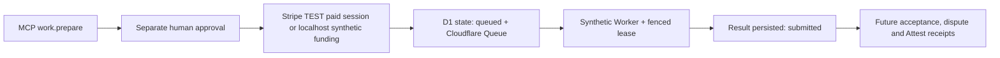

# Contract approval, Stripe TEST funding and Queue execution (v0.2)

**Status: runnable sandbox, not production payments, not external agent work.**

This layer sits over AWC's commercial `WorkOrder` and never treats an MCP Task handle as the contract. The user wants to hire specialized agents, but this first vertical slice deliberately executes a **deterministic synthetic Worker only**. It proves lifecycle boundaries and failure modes without putting real customer funds or proprietary data at risk.

## State and trust model



**Allowed states:** `prepared_unfunded -> approved -> checkout_pending -> funded -> queued -> running -> submitted`, with `failed` terminal pending manual resolution. In local sandbox, `approved -> funded` uses a clearly labeled *synthetic* funding event. Stripe `checkout_pending -> funded` requires server-side verification.

- The public MCP tools are `catalog.search`, `catalog.get_offering`.
- An authorized buying agent gets `quotes.request`, `work.prepare`, `work.get`, `billing.options`, optionally `billing.checkout`, `billing.reconcile`, `work.start`.
- **There is intentionally NO `work.approve` MCP tool**. The human approval occurs separately at `/review?work=...`, with an independent approval-audience OIDC token (or a distinct local-only manual secret).
- `work.prepare` renders the `ui://awc/contract.html` App and returns a public non-secret browser URL for reviewing the precise contract digest, scope and amount.
- The human reviewer is authenticated as the same buyer but through a **different audience**, configured client, allowed authentication context (`acr`) and recent `auth_time`; agent bearer credentials cannot satisfy the review endpoint.
- `/review` uses a manual human token entry in this prototype. A real deployment needs hosted OIDC authorization code + PKCE, secure same-site session cookies, CSRF, accessible consent UX and step-up.
- Work state is D1-backed, compare-and-swap using `version` and status. Repeated funding reconciliation after execution remains idempotent for the same matching session; quote and input commitments are immutable.
- Queue delivery is **at least once**, not exactly once. A single-fenced execution lease and deterministic Worker make duplicate messages safe for the sandbox. Work start sets D1 to queued, then sends a Queue message; a cron recovery scan resends queued and expired-running jobs. External workers with side effects must have additional idempotency and uncertainty reconciliation before they can be connected.
- Terminal work results are persisted in D1 for later inspection. They are not cryptographic Attest receipts and do not imply human acceptance.

## Local setup

1. Install Node 24+ and pnpm 10, then `pnpm install --no-frozen-lockfile`.
2. Create a D1 database `awc-catalog` and replace the all-zero UUID in `apps/server/wrangler.jsonc`.
3. Create a Queue `awc-work-jobs` using Wrangler, which is configured as both producer and consumer in the same Worker.
4. Run `pnpm --filter @awc/mcp-ui build`.
5. Run `pnpm --filter @awc/server exec wrangler d1 migrations apply awc-catalog --local`.
6. Create `apps/server/.dev.vars` (gitignored) with independently random 32+ character values:
   ```dotenv
   ENABLE_LOCAL_SANDBOX=true
   AWC_BUYER_TOKEN=<one random secret for the buying agent>
   AWC_SANDBOX_HUMAN_TOKEN=<different random secret for the human review page>
   ENABLE_X402_TESTNET=false
   ```
7. Run `pnpm --filter @awc/server dev`; point an MCP v2 client at `http://localhost:8787/mcp`, setting the buyer token in its **secure** authorization configuration, not in the prompt.
8. Call `catalog.search -> quotes.request -> work.prepare`. Copy the returned `reviewUrl` or open the Contract Inspector MCP App. In a separate browser visit `/review?work=<workId>` and enter the **human token**, inspect the quote/digest, approve and (local only) click "Simulate funding".
9. Return to the buying agent, call `work.start`, then `work.get` to see the synthetic result. A registered Queue consumer performs the job after funding is verified. No external AI inference and no real-money charge occurs.

The separate human credential should *never* be given to the buying agent, stored in MCP resource content, or placed in a URL.

### Stripe TEST Checkout

- Optionally set `STRIPE_SECRET_KEY=sk_test_...` and `STRIPE_WEBHOOK_SECRET=whsec_...` via secret storage. **Live Stripe keys are deliberately rejected.**
- After human approval, `billing.checkout` creates a Stripe TEST hosted Checkout Session with immutable work ID, buyer ID, offering ID, quote digest, currency and exact minor-units amount. The same work ID is Stripe's idempotency key.
- The human pays via Stripe's hosted test page. Signed webhook events `checkout.session.completed` and `checkout.session.async_payment_succeeded` trigger server-to-server re-query of the session. The optional `billing.reconcile` tool does the same.
- The verifier rejects mismatched work, buyer, offering, contract digest, price, currency, unpaid, incomplete or `livemode=true` sessions. It does not accept an event body or URL as settlement evidence.
- Only then does `work.start` queue the synthetic Worker.

**Production blockers:** robust payment-intent and charge/refund/chargeback reconciliation; a persistent webhook-event inbox for durable dedup/retry; operational Stripe account governance, taxes, merchant-of-record and provider payout decisions, audited authorization and a reviewed release mode. A successful redirect is not payment confirmation.

### Poppy, x402 and Cloudflare Gateway

- The existing **Base Sepolia testnet** `sandbox.paid_text_stats` SDK tool remains optional and separate. It does not fund work orders.
- Cloudflare Monetization Gateway is closed beta and supports documented x402 `exact` and `upto` schemes with its own limits; no production Gateway rule is created by this PR.
- Origin `PAYMENT-CONTEXT` proves Gateway *authorization* when cryptographically verified; for long gigs it cannot be blindly treated as a post-settlement work-order payment receipt.
- Streaming usage requires a separate ledger/batch mechanism; work orders may use Stripe or a later reviewed direct x402 settlement verifier.
- Provider registration, signed catalogs, Poppy discovery, MCP Tasks asynchronous **protocol** projection, brokered external jobs, Stripe Connect splits and Attest claims are subsequent slices.

## Threat model / negative testing

- Separate OAuth audiences and exact role/scopes for agent vs human approval; no token copying into chat or app.
- Work/buyer/quote/input digest binding and idempotency. Swapped terms and cross-buyer attempts rejected.
- Stripe TEST session metadata and amount independently checked. No live credentials.
- D1 optimistic compare-and-swap for concurrent starts; Queue messages can duplicate and retries won't execute a submitted job twice.
- Workers must be idempotent and compensate/reconcile external effects before generalization. Lease expiry without heartbeat means this sandbox must remain deterministic and bounded.
- No arbitrary remote artifact URLs or provider code execution. Fictional providers clearly labeled.
- CSP on human review page, host-mediated links for MCP App, rejection of browser cross-origin requests, and server-side policy for every tool.
- Untrusted model/provider text never produces spending authority or proof of payment.

## Related

- `docs/mcp-server-design.md`
- `docs/monetization-gateway.md`
- `specs/agent-work-catalog` (forthcoming)
- `gmackie/attest#9` for future verifiable work receipts.
