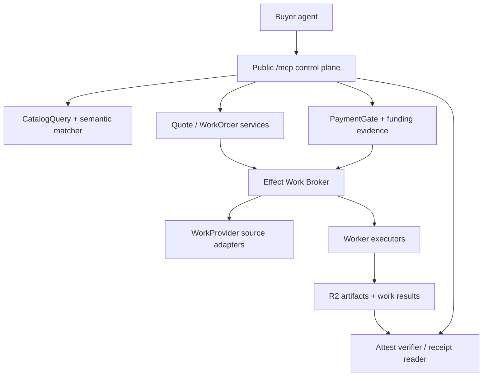
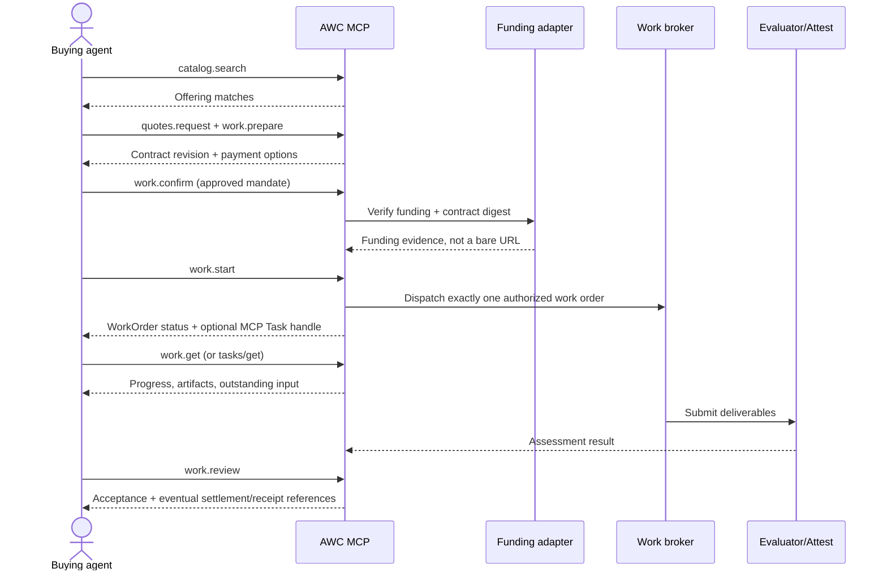

# AWC MCP Server — protocol and product design (draft v0.1)

**Status:** design-only proposal, not deployed. **Target:** MCP 2026-07-28 (stateless), with optional MCP Apps and MCP Tasks extensions. Must preserve a compatibility path for earlier clients. **Principle:** the MCP server is a procurement/control plane; contracts, execution and payments are independent domain services.

## 1. Vocabulary: do not conflate task types, work orders and execution tasks

- `TaskType`: versioned semantic *kind of outcome* (e.g. diagnose a Modbus PCAP).
- `Offering`: a provider's purchasable implementation (price, schema, capabilities, evidence).
- `Quote`: immutable proposed terms, with expiration and a content commitment.
- `WorkOrder`: buyer/provider commercial agreement, with permissions, price ceiling, acceptance criteria and status.
- `Execution`: one or more worker attempts to fulfill a WorkOrder, including retries and subcontracting.
- `MCP Task`: **optional protocol handle** for one long-running tool invocation. NOT a WorkOrder, and not our task taxonomy.
- `WorkProvider`: adapter for an *upstream source of assignments*, as defined in `@awc/runtime`; distinct from a marketplace seller.
- `Worker`: execution runtime receiving normalized WorkOrder inputs and returning results/artifacts.

A WorkOrder may have many executions (including reviewers and revisions), and a single execution may map to an MCP Task, A2A Task, OpenAI Responses background response, Workflow run, or other provider-specific handle.

## 2. MCP transport and deployment

- Stateless Streamable HTTP at `POST /mcp` on a Cloudflare Worker using current `@modelcontextprotocol/server` and `createMcpHandler` from Cloudflare Agents; no protocol session or Durable Object is required for the transport. Persist application contracts separately.
- Per-request `MCP-Protocol-Version: 2026-07-28`, `Mcp-Method`, `Mcp-Name`, plus client info/capabilities in request `_meta`; client may call `server/discover`. **Origin must reject header/body mismatch**. Retain adapters for older initialization-based clients where needed.
- MCP server handles `tools/list`, `tools/call`, `resources/list`, `resources/templates/list`, `resources/read`, optional `prompts/list`, and capability-negotiated extensions. List/read caches must be appropriately scoped (`ttlMs`, `cacheScope`).
- Public entry: `/.well-known/poppy.json`, `/.well-known/agent-work-catalog.json`, OAuth resource metadata and a human-facing `/connect` page. Poppy is optional; authenticated MCP works without it.
- One principal/client OAuth authorization per request. Read-only public catalog methods may be available signed-out. Authenticate using nathan or a standards-compatible issuer and resource audience `https://catalog.example/mcp` (example domain only).
- Never assume a generic MCP client can automatically pay HTTP 402. Provide payment-option and hosted-checkout fallbacks.



## 3. Tool design: small, model-visible, permission-scoped

Tool input and output schemas are versioned and validated independently of the model's arguments. Each tool returns both a human-readable summary (`content`) and structured JSON (`structuredContent`, with `outputSchema`). Each mutation needs idempotency keys and deterministic policy checks. Errors expose stable typed codes, never raw secrets.

| Tool name | Purpose / important inputs | Authorization | Side effect |
|---|---|---|---|
| `catalog.search` | Intent, semantic tags, output format, budget, effects, data class; ranked explainable matches | public (rate-limited) | read |
| `catalog.get_offering` | Immutable offering ID + version; schemas, prices, evidence requirements | public | read |
| `catalog.compare` | 2-6 offering IDs and buyer requirements; structured compatibility differences | public | read |
| `catalog.get_task_type` | Canonical task type + version, inputs, effects, outputs | public | read |
| `providers.inspect` | Provider origin, Poppy/A2A/OpenAPI/MCP links, verified attestations | public | read |
| `quotes.request` | Offering + buyer scope + input references + budget + deadline | `quotes:write` | quote generation; no charge |
| `quotes.get` | Quote ID + revision; immutable commitments and expiry | quote parties | read |
| `work.prepare` | Quote revision, data policy, requested effects, mandate budget, unique idempotency key | `work:write` | reserve a proposed work order, **not funded** |
| `work.confirm` | Work order ID, **trusted authorization reference**, payment proof reference | `work:authorize` | conditional legal/financial acceptance |
| `work.start` | Funded, accepted work ID; stable idempotency key | `work:execute` | dispatch to Worker; potentially MCP Task |
| `work.get` | Work ID, optional event cursor | work parties | read; status + event cursor |
| `work.list` | Authorized buyer or seller work, status/page; **domain tool, not MCP tasks/list** | `work:read` | read |
| `work.cancel` | Work ID, reason; returns cancellation eligibility/decision | `work:write` | cancellation request, not guaranteed refund |
| `work.review` | Work ID, acceptance policy + revisions; accept/reject/request changes | `work:review` | may trigger settlement; gated by policy |
| `billing.options` | Quote/work ID; available x402 schemes, Stripe Checkout or provider credits | `billing:read` | read, no wallet signing |
| `billing.balance` | Bound credit account; available/reserved funds | `billing:read` | read |
| `receipts.verify` | Receipt ref or presented credential bundle, verification policy | `receipts:read` (public receipts allowed by consent) | independent verification, no claim issuance |
| `provider.publish_offering` | Signed/approved provider listing + schema + price | `provider:write` | catalog publication; separate admin role |

V1 **model-facing core** should expose roughly 10-12 common tools by default: search, get offering, compare, quote, prepare, confirm, start, get/list, review, billing options, verify receipts. Hide advanced provider management and financial administration unless authorized. Discovery tools must be *read-only*, purchase tools not.

Tool annotations are advisory (`readOnlyHint`, `destructiveHint`, `idempotentHint`, `openWorldHint`). Never use annotations to replace server policy; mark work confirmation and review as potentially destructive/open-world. Separate `work.prepare` from `work.confirm` so an LLM cannot turn search into an unnoticed purchase.

### Example: catalog.search

```json
{
  "name": "catalog.search",
  "description": "Find purchasable offerings matching a requested outcome.",
  "inputSchema": {
    "type": "object",
    "properties": {
      "intent": {"type":"string", "minLength":3, "maxLength":2000},
      "maxPriceMinor": {"type":"string","pattern":"^(0|[1-9][0-9]*)$"},
      "currency": {"type":"string","enum":["USD"]},
      "outputMediaTypes":{"type":"array","items":{"type":"string"},"maxItems":10},
      "dataClassification":{"enum":["public","internal","confidential"]},
      "limit":{"type":"integer","minimum":1,"maximum":20}
    },
    "required": ["intent"],
    "additionalProperties": false
  },
  "annotations": {"readOnlyHint":true,"destructiveHint":false,"idempotentHint":true,"openWorldHint":true},
  "_meta": {"ui":{"resourceUri":"ui://awc/marketplace.html"}}
}
```

```json
{
  "structuredContent": {
    "queryId": "qry_123",
    "matches": [{
      "offeringId":"off_987",
      "offeringVersion":"3",
      "taskTypeId":"task:industrial.modbus.diagnosis/v1",
      "eligible":true,
      "reasonCodes":["INPUT_FORMAT_SUPPORTED","BUDGET_WITHIN_LIMIT"],
      "price":{"currency":"USD","minorUnits":"3500"},
      "termsDigest":"sha256:example-only"
    }]
  },
  "content":[{"type":"text","text":"One offering meets the requested constraints."}]
}
```

## 4. Resource design

Resources are **read-only reference material**, not mutable APIs or a replacement for tools. Prefer immutable versioned content and short, contextual data. Use `resources/templates/list` for dynamic URIs; `resources/read` enforces access and output constraints.

| URI template | Content | Cache / disclosure |
|---|---|---|
| `awc://taxonomy/task-types/{id}/{version}` | Semantic task definition; OASF/SKOS links | long public cache |
| `awc://offerings/{providerId}/{offeringId}/{version}` | Versioned offering, input/output/terms schemas | public with moderate TTL; no private data |
| `awc://providers/{providerId}/capabilities` | Provider protocols, availability policy, verified claims | public short cache |
| `awc://schemas/{schemaId}/{version}` | JSON Schema / semantics | immutable public |
| `awc://work-orders/{workOrderId}` | Sanitized agreement, state and event cursor | private only, no cross-user caching |
| `awc://work-orders/{workOrderId}/deliverables` | Authorized artifact descriptors, signed URLs only on retrieval | private, short/no cache |
| `awc://receipts/{receiptId}` | Verifiable credential bundle or privacy-preserving presentation | requester-bound unless explicitly public |

Never expose an arbitrary `https://` source directly as a server-side fetch. Private artifacts must pass tenant, object ACL, content-hash, size and MIME checks. A receipt verification tool must validate issuer authority and current status rather than merely reporting a signature match.

## 5. MCP Tasks extension vs AWC WorkOrder

The 2026-07-28 `io.modelcontextprotocol/tasks` extension is an **optional projection for individual tool calls**:
- Client declares extension on each request. If the server needs to run `work.start` asynchronously, it may return `CreateTaskResult` (`resultType:"task"`, task ID) only for opted-in clients.
- Server durably stores the MCP task handle before returning it; client uses `tasks/get`, `tasks/update` for input requests, `tasks/cancel` for cooperative cancellation, and optional `subscriptions/listen` to receive `notifications/tasks`.
- No MCP `tasks/list` on modern extension; use `work.list` for the user's *commercial work*.
- If client lacks the extension, `work.start` can instead return a normal immediate result containing the WorkOrder ID and status URL; no fabricated MCP task handle.
- MCP-task cancellation only cancels the specific execution attempt. It **does not** automatically void the contract, cancel subcontractors, refund/capture money, or revoke delegated access.

Track three independent state machines:
- Commercial: `proposed -> quoted -> accepted -> funded -> running -> submitted -> under_review -> accepted | revisions_requested | disputed | cancelled`.
- Execution: `queued -> running -> input_required | completed | failed | cancel_requested | cancelled`.
- Financial: `unfunded -> authorization_pending -> authorized -> captured | settled | voided | refunded | disputed`.
Use durable event IDs and source IDs; don't overwrite immutable quote/contract revisions.



## 6. MCP Apps (optional but first-class)

Register each View as a static `ui://` resource with `text/html;profile=mcp-app`, referenced from the corresponding tool in `_meta.ui.resourceUri`. Host fetches with `resources/read` and renders in a sandboxed iframe. Tool results and app-to-server calls are mediated by the host. Render useful plain text/structured data when host doesn't support MCP Apps.

| View | Trigger | Interactive jobs |
|---|---|---|
| `ui://awc/marketplace.html` | `catalog.search` | Results, facets, evidence badges, compare selection |
| `ui://awc/compare.html` | `catalog.compare` | Side-by-side pricing, fit, constraints and verification |
| `ui://awc/contract.html` | `work.prepare` | Quote/contract inspection, permitted effects, explicit user approval |
| `ui://awc/workboard.html` | `work.get` | Progress, artifacts, revisions, cancel, evaluation |
| `ui://awc/receipts.html` | `receipts.verify` | Visual claims provenance: who asserted what and at which assurance level |
| `ui://awc/provider.html` | `provider.publish_offering` | Provider catalog and price editor, publishing checks |

UI-only tools with `_meta.ui.visibility:["app"]`: `ui.get_page`, `ui.compare_selection`, `ui.preview_terms`, `ui.refresh_workboard`. Do **not** hide sensitive authorization behind app-only controls: trusted approvals and payments require independently authenticated server-side decisions, nonce and signed mandate/consent when appropriate. Keep wallet keys, provider API secrets and OAuth refresh tokens outside the iframe.

## 7. Consent, authorization and observability

- OAuth resource metadata and strict audience-bound access tokens. Poppy session identity is optional addition, never substitute for OAuth scope or resource rights.
- Per-tool `read`, `quote`, `purchase`, `execute`, `review`, `provider.write` authorization; Gatekeeper enforces exact provider, source, tenant, task type, allowed effects, data classification and budget.
- Contracts are canonical/digest-bound; signed spending mandates from `gmackie/attest` can prove delegated authority; a model's assertion of approval cannot.
- Hard filter candidates before semantic ranking; provider text is untrusted (prompt-injection isolation). A tool returning `eligible:true` is not authorization.
- Use OpenTelemetry trace context, structured error codes, safe pagination, per-buyer quotas and anti-enumeration. Avoid putting private artifact content into logging or public resource caches.
- MCP Apps UI and external payment redirects should display contract terms and vendor/payment recipient unambiguously.

## 8. Effect monorepo implementation plan

- `packages/mcp-contracts`: exported Effect Schema definitions for tool inputs, outputs, resources and UI actions.
- `packages/mcp-server`: stateless MCP server facade + tool registry; adapts Effect services to MCP SDK v2.
- `packages/catalog`: task taxonomy / eligibility; add catalog repository and indexed search service (vector candidate retrieval + deterministic policy).
- `packages/runtime`: WorkProvider/Worker/Broker ports and execution; add durable workflow and outbox.
- `packages/payments`: PaymentGate and funding option selectors (Stripe, Cloudflare Gateway x402, direct x402, credit ledger).
- `packages/attest-adapter`: verifiable qualifications and work-receipt claims via Attest Issue #9.
- `apps/mcp-ui`: static React or Kumo compiled MCP Apps resources; dynamic state via app-visible tools.
- `apps/server`: Cloudflare Worker route composition and OAuth metadata, public discovery, MCP, payment action routes.

Initial vertical slice: `catalog.search -> catalog.get_offering -> quotes.request -> work.prepare -> billing.options -> work.confirm -> work.start -> work.get -> receipts.verify` with a deterministic worker, simulated payments and two distinct provider offerings. Only enable real Stripe/x402 after trusted offering routing, durable execution, and payment reconciliation.

## 9. Conformance / safety tests

- Modern MCP header/body mismatch, absent capabilities, 2025-era client fallback, malformed `structuredContent`, resource cache isolation.
- WorkOrder is not an MCP Task; task ID not enumerable or sufficient for financial authorization.
- Budget/concurrent spend across delegated agents; duplicate commit/start/settlement; quote digest/price substitution; provider spoofing.
- No payment charged to search, list, quote lookup or ordinary status checks.
- Paid call with missing/invalid funding, wrong wallet, wrong resource audience, wrong quote, stale/used authorization.
- UI-only tool visibility and app fallback; UI cannot approve/charge directly.
- x402 retries and 402 clients; oversized inputs, prompt injection, artifact SSRF, private evidence leak.
- Cancellation, refund/dispute and crash recovery all tested separately.

## Primary references (verified Oct 31, 2026)

- https://blog.modelcontextprotocol.io/posts/2026-07-28/
- https://tasks.extensions.modelcontextprotocol.io/
- https://github.com/modelcontextprotocol/ext-apps/blob/main/specification/2026-01-26/apps.mdx
- https://developers.cloudflare.com/agents/model-context-protocol/apis/handler-api/
- https://developers.cloudflare.com/agents/tools/payments/x402/charge-for-mcp-tools/
- https://developers.cloudflare.com/monetization-gateway/
