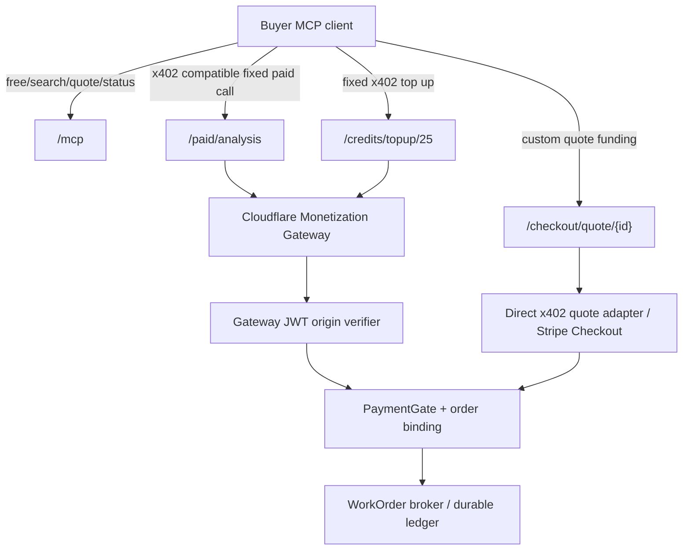
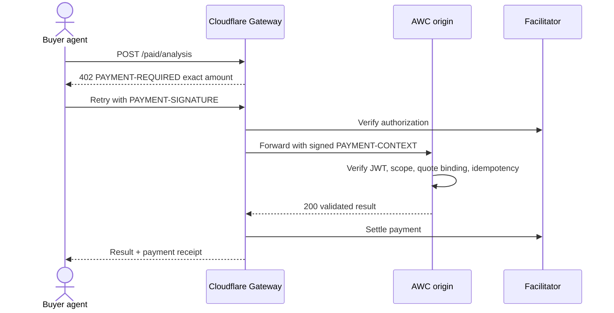

# Cloudflare Monetization Gateway evaluation for AWC (Oct 31, 2026)

**Status:** architecture research, not enabled in Cloudflare, no wallet configured and no production payments. The official product docs were last updated September 30, 2026. This document distinguishes **Monetization Gateway at the edge** from **Cloudflare Agents SDK's `agents/x402` paidTool helper** and from **MPP (Machine Payments Protocol)**.

## 1. Verified published capabilities

Cloudflare Monetization Gateway is a **closed beta**, currently for U.S.-based buyers and sellers. Seller account: older than 60 days, verified email, card on file, approved security checks and service terms. Proxied zone: older than 30 days, zone security checks.

You create rules matching URL, method (GET by default; configure POST explicitly), headers, query, user-agent/caller properties; request-body matching is Enterprise only. Payment rules specify an audience (everyone or BotBase Verified Bots), wallet, and charge.

The Gateway uses x402 **v2**. Published rule scheme support is:
- `exact`: fixed price; Gateway settles signed amount; origin **must not** set `PAYMENT-SETTLEMENT`.
- `upto`: buyer authorizes max; origin computes charge and sets `PAYMENT-SETTLEMENT` JSON (`{"amount":"<integer atomic units>"}`) **before sending response headers**, only for successful (status <400) response. If actual > authorized max, Gateway settles only max; zero actual settles nothing.

Published limits: **$0.001 minimum settlement** and **$100 maximum price**, quoted in atomic USD-equivalent units at 10^-6 ($0.001 = 1000 units, $100 = 100000000). Confirm selected asset/network with actual Gateway config; do not assume arbitrary tokens or networks.

Protocol headers:
1. Buyer calls resource -> HTTP `402` and base64 JSON `PAYMENT-REQUIRED` (accepted scheme, network, asset, max/fixed amount, payTo, resource).
2. Buyer signs according to x402 client SDK, retries with `PAYMENT-SIGNATURE`.
3. Gateway verifies, forwards to origin with signed `PAYMENT-CONTEXT` JWT.
4. Origin verifies signature using Cloudflare's **pinned JWKS**, Ed25519, expected audience, expiry, scheme and amount. Missing/invalid context means **unpaid**, fail closed.
5. Origin returns successful result and optional `PAYMENT-SETTLEMENT` for `upto`; Gateway settles using Coinbase x402 Facilitator, adds its payment receipt; the origin's settlement header is removed from buyer response.

**Do not trust an unsigned copied request header, user-supplied transaction URL, or a raw payment signature passed to an origin behind a bypass path.** Verify JWT and make origin unreachable through unprotected aliases or service endpoints; also enforce business authorization, task/quote binding, and idempotency.

## 2. Fit to Agent Work Catalog

| AWC operation | Gateway fit | Decision |
|---|---|---|
| Catalog discovery/search, `tools/list`, `resources/read` | Charging discourages onboarding | **Free**, auth/quotas as appropriate |
| Small fixed priced data / specialized `paidTool` | Strong: `exact`, fixed amount per invocation | **Good pilot** |
| Bounded variable, non-streaming inference | `upto`, origin settles actual amount before headers | **Good pilot** with strict maximum |
| Live token streaming | Actual final usage unknown before headers | **Not a direct Gateway `upto` fit**; choose credits or another reviewed mechanism |
| Prepay $5 / $25 / $100 of credits | Fixed exact amount and idempotent ledger funding | **Good pilot** using separate fixed-denomination routes; no double credit |
| Arbitrarily priced custom work order | Static edge rule cannot reliably price arbitrary quote/body for all plans; cap $100 | **Use broker/direct x402 quote action or Stripe**, with digest-bound funding |
| $250+ completed gig or milestone escrow | Exceeds published price max; no published escrow/capture API | **Use Stripe/merchant workflow**, not Gateway as escrow |
| Multi-seller automatic payment splits | Not documented as built-in for dynamic seller assignment | Provider wallet per rule or separate compliant payout system |
| Global agent marketplace | Closed beta + U.S. restrictions | **Pluggable fallback mandatory** |

**Important:** Cloudflare's Agents SDK also exposes `withX402` + `paidTool(name,description,price,...)`, a server-side x402 helper that can mix free and paid tools. This is **not** the same product as Monetization Gateway: it puts payment handling in your MCP Worker, uses a configured facilitator, and published examples show fixed per-tool prices. The current examples note a v1 MCP SDK type peer dependency even when using an SDK v2 server; pin/test exact compatible versions. Cloudflare's migration guide says `withX402` works with SDK v2 from agents@0.27.0; avoid guessing APIs across versions.

Cloudflare also documents **MPP**: a different payment protocol supporting cards through Stripe plus stablecoins, with x402-client compatibility in some client implementations. It's a possible future interoperability adapter, not a reason to silently replace our x402 merchant contracts.

## 3. Tool-level pricing on one MCP endpoint: opportunity and danger

MCP `2026-07-28` requires routing headers on Streamable HTTP, including:
```http
POST /mcp HTTP/1.1
MCP-Protocol-Version: 2026-07-28
Mcp-Method: tools/call
Mcp-Name: premium_analysis
```

Because Gateway rules can match headers and POST, we can **experiment** with an `Mcp-Name: premium_analysis` rule and leave `Mcp-Name: catalog.search` free.

But headers are client-supplied, so the MCP origin MUST reject header/body mismatches. A Gateway JWT with `aud` of the generic `/mcp` URL may not bind the paid authority to an *individual tool/quote* by itself. Our application must bind the funded invocation to exact tool/contract and never grant unlimited execution from the mere presence of a valid payment context. Test replay, amount substitution, tool-name switching, caller-ID substitution, and permission bypass.

**Preferred safer topology:**

Do not put `/mcp` discovery behind a blanket paid rule. Advertise paid HTTP execution URLs via catalog / Bazaar and expose selected paid MCP tools with SDK helper if the client supports x402. For a quote-specific amount, `/checkout/quote/{id}` is **our own adapter**, not a Gateway capability.

## 4. Example payment flows

### A. Fixed paid invocation (Gateway `exact`)



For a purely synchronous, reasonably bounded paid tool, this works well. If a tool has external side effects or inference cost, maintain durable idempotency and reconcile uncertain settlement outcomes; a payment failure after expensive work is still possible.

### B. Metered non-streaming (Gateway `upto`)

Set upper bound based on server-owned quote and max tokens. Verify that the payment JWT authorizes that ceiling. Run a bounded non-streaming call, compute actual metered charge, return successful output with `PAYMENT-SETTLEMENT: {"amount":"..."}` **before headers**. For provider charge < $0.001, consider coalescing usage into provider credit debit; don't round up silently unless explicit minimum pricing terms were accepted.

Never blindly charge a full maximum. Never silently absorb unbounded execution when the actual charge exceeds the approved ceiling: truncate or reject before execution using explicit max-token limits.

### C. Stripe or x402-funded prepaid credits

Use independent fixed-price routes for known denominations:
```text
POST /credits/topup/5
POST /credits/topup/25
POST /credits/topup/100
```
These are server-owned SKU prices and not freely supplied JSON prices. After confirmed successful settlement, credit the authenticated *provider-specific* account once using transaction idempotency. Separate the payment receipt from internal ledger reservation/debit receipts.

Subsequent streaming model calls go through `/v1/responses` or the authenticated Worker service with a durable balance reservation and post-execution actual debit; **not every call is individually settled by x402**. Provider credits are a financial liability; handle refunds, chargebacks, expiry and accounting explicitly. Do not add transferable universal credits until regulatory and treasury review.

### D. Completed gigs

Broker `work.prepare` stores immutable contract digest and exact funded amount. `billing.options` returns provider-appropriate rails. For a priced gig, confirmation first records trusted buyer authorization; funding is verified independently and linked to the same contract revision. Actual execution begins only after the gate passes. Refunds, disputes and buyer acceptance are separate from an x402 payment event. Gateway payments are **not escrow**.

## 5. Bazaar discovery caveat

x402 Bazaar discovery is an **optional facilitator feature**. It indexes payment resource metadata from the `extensions.bazaar` object on an x402 v2 payment-required exchange, including endpoint/tool invocation schema. It does not infer outcomes, acceptance policy or Attest proof claims.

The published Monetization Gateway docs do not promise that a Cloudflare rule automatically publishes arbitrary Bazaar metadata or is indexed in a Bazaar directory. **Probe this**, and if absent, use our own signed AWC offering catalog and a self-managed x402/Bazaar-compatible HTTP endpoint for distribution. Never market “automatically indexed in Coinbase Bazaar” without observing an index entry.

## 6. Security and acceptance test matrix

- Beta eligibility and feature toggle; fallback origin still works without Gateway.
- Match free versus paid routes; POST explicitly enabled; tool-header spoof and header/body mismatches fail.
- Validate `PAYMENT-CONTEXT`: Ed25519 pinned JWKS, `aud`, timestamps, scheme, amount; no direct origin bypass.
- Correct handling of `exact` vs `upto`: settlement only on successes, charged amount within ceiling, no settlement header on errors, no unauthorized zero-cost work.
- Payment reused for distinct quote/tool/tenant denied; idempotent retries do not re-execute expensive work without contract policy.
- Streaming non-compatibility is a documented fallback, not an untested partial charge.
- $0.0005, $0.001 and $100.01 boundary prices; invalid or unsupported currencies/assets/networks rejected.
- Confirm actual Stripe settlement from trusted API/webhook and reconcile refunds/chargebacks.
- Credit top-up exactly-once issuance, parallel debit reservations, insufficient funds, crash/compensation and refund.
- Indexed Bazaar listing is verified end-to-end and no private catalogs leak to public discovery.
- Full evaluation/Attest claims remain separate from settlement truth and merchant payout.

## Useful official documentation

- https://developers.cloudflare.com/monetization-gateway/
- https://developers.cloudflare.com/monetization-gateway/eligibility/
- https://developers.cloudflare.com/monetization-gateway/configuration/rules/
- https://developers.cloudflare.com/monetization-gateway/configuration/payment-validation/
- https://developers.cloudflare.com/monetization-gateway/x402/
- https://developers.cloudflare.com/agents/tools/payments/x402/charge-for-mcp-tools/
- https://developers.cloudflare.com/agents/model-context-protocol/guides/migrate-to-mcp-sdk-v2/
- https://developers.cloudflare.com/agents/tools/payments/mpp/
- https://github.com/x402-foundation/x402/blob/main/specs/extensions/bazaar.md
