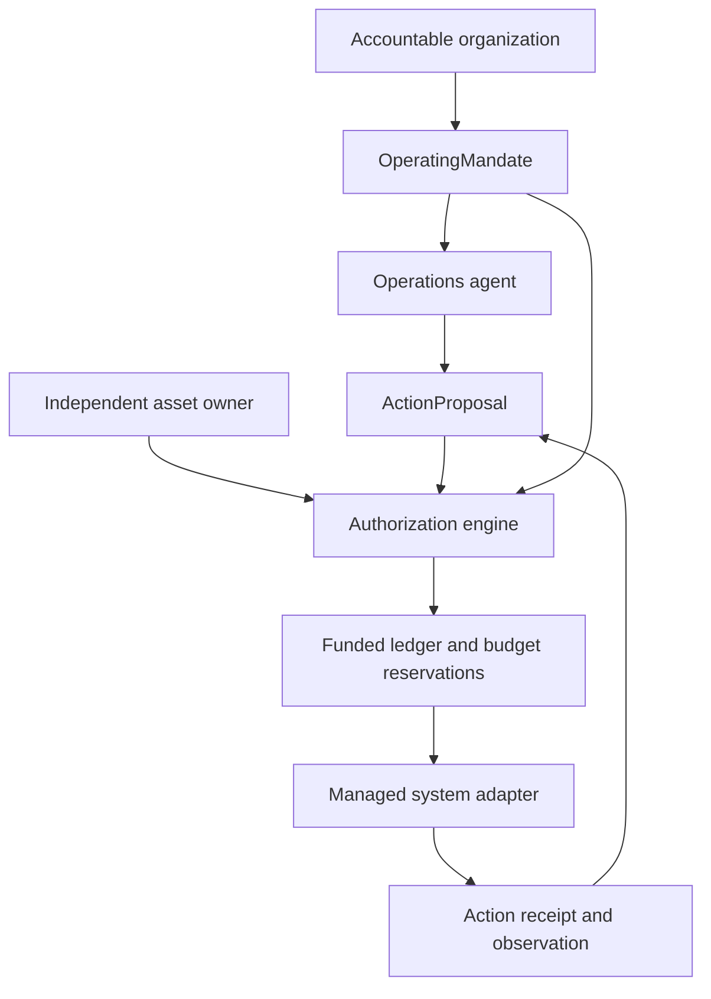

# Operations and Responsibility: implementation design

The implementation lives under `@awc/responsibility`, `@awc/economics`, `@awc/operations`, `@awc/adapter-sdk`, `@awc/simulations`, and the executable `apps/operations-demo`.

## Roles



The agent plans actions. No LLM-generated string can itself satisfy a finance/account-ownership check or forge an independent approval. The simulator's trusted owner grants, budget and approval evidence are injected by the test environment, not caller tools.

## Effect services / composition

- `OperatingMandate` and `ActionProposal`: declarative Effect Schema in `@awc/responsibility`.
- `evaluateAction(proposal, trustedContext)`: pure policy evaluation, with four decisions and machine-readable reason codes.
- `EconomicLedgerService`: two independent bounds, delegated authority ceiling and account available funds. Demo-only ledger.
- `OperationsService`: reference coordinator that re-evaluates at commit and writes only to an in-memory simulated adapter.
- `ManagedSystemAdapters`: registry validating managed-system manifests with no arbitrary package loading. Remote read-only adapters cannot expose write capabilities.
- `runScenario(id)`: deterministic in-memory domain simulation; returns receipts, state, obligations, costs and action decisions.

## The three simulations

| Environment | Observed issue | Agent proposal | Expected result |
| --- | --- | --- | --- |
| Vending | Stock nearly exhausted | `inventory.replenishment.request` | Synthetic restock request, bounded $18 authorization |
| Cloud | High request rate and latency | `capacity.acquire` | Synthetic capacity allocation, bounded $35 authorization |
| Plant | Production throughput poor | Maintenance ticket, schedule change, PLC write | Maintenance allowed; schedule escalated; PLC write denied |

All USD figures are **fictitious simulated authority**, not payment charges. None of the simulators touches a machine, cloud account, PLC, wallet or external agent.

## Development commands

```bash
pnpm install --no-frozen-lockfile
pnpm typecheck
pnpm test
pnpm operations:demo
pnpm --filter @awc/mcp-ui build
pnpm --filter @awc/server bundle
```

To explore from any compatible MCP client, use `operations.scenarios` and `operations.simulate`. The optional App `ui://awc/operations.html` shows budgets, obligations, and denied/escalated actions. MCP clients without Apps see the same structured output.

## Production implementation roadmap

1. **Trust registry**: mandate and owner-permission issuer verification, immutable versions, revocation/status and counterparty checks; human OIDC approval separated from agent identity. Map to Gatekeeper; signed Attest issuers separately.
2. **Durable economics**: serializable account and hierarchy reservations across WorkOrder/ResourceLease lifecycles; settlement and refund ledger via Stripe/x402 account owner. Never reuse in-memory seeded funds for production.
3. **Action gateway**: validated adapter registry, typed allowed actions, authorization close to resource, versioned observations, durable outbox, lease reconciliation, independent site safety policies.
4. **Continuous operations**: obligation assessment at declared measurement windows, scheduled reconciliation, incident/event intake, work commissioning, handover, degraded status and incident escalation.
5. **Regulated/OT deployment**: read-only inventory and telemetry first. Never issue raw PLC writes or safety overrides through generic WorkOrder or MCP infrastructure. Qualified site team owns safety, operating procedures and equipment control.
6. **External evidence**: signed action claims, independent evaluation, payment settlement and verifiable receipts using Attest, with privacy-preserving selective presentations and provenance bindings.

## Economic and legal cautions

A business-level spending mandate is not a payment instrument or actual treasury funding. An accountable organization remains legally responsible for actions under its service agreements. An execution may have unresolved accrued costs even after an agent is revoked. A cloud/plant resource adapter MUST independently verify cleanup, lease release, refunds, retained volumes, unresolved supplier commitments and obligations.

Current v0.1 code provides a tested sandbox **reference model only**. There is no production issuer, trusted external provider onboarding, digital signing, cryptographic revocation, legal automation or real-world control.

## Anti-abuse test inventory

- Parent/child attenuation of identity, time, entities, effect class, data classification and spending limits.
- Sibling submandate oversubscription and concurrent purchasing under one funded account.
- Missing or stale telemetry; denied physical control; wrong resource-owner permission.
- Agent without funds; spending grant without legal account; approval bound to wrong proposal revision.
- Revocation of parent and child; duplicate action idempotency; no double capture.
- Missing or incompatible measurement sources return unknown objective status.
- Wrong tenant, fake funding receipts, scenario ID injection and arbitrary adapter URLs rejected.
