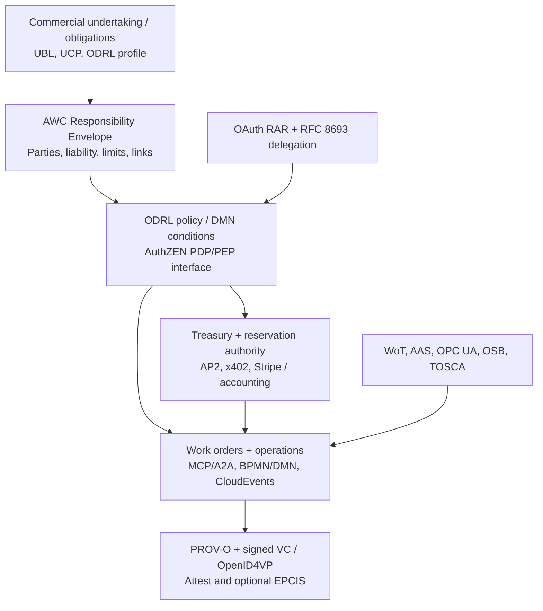

# Standards-first AWC architecture: existing protocols to reuse

**Research date:** 2026-11-01  
**Status:** Architecture proposal; no external compliance or production integrations implied.  
**Scope:** Economic and operational delegation, work marketplaces, long-running operations, procurement, machine/asset integration and evidence.

## Recommendation

AWC should be a **profile and composition layer** over existing standards rather than a new general-purpose agent authorization, workflow, asset model or payment protocol.

The clearest missing interoperability object is a **Responsibility Envelope** binding (a) a long-lived commercial obligation, (b) the accountable legal/organizational party, (c) a versioned and attenuated operational grant, (d) an independently controlled payer/account, (e) a concrete action/work order or resource lease, and (f) verifiable outcome/provenance evidence.

Policy expression, authorization API, agent task transport, payment settlement, purchase/order documents and digital-twin discovery should remain under their established standards. One business operation may need multiple independent authorities.

## Standards to adopt, adapt or monitor

### P0: Architectural foundations

| AWC concern | Standard / version | Concrete reuse | Boundary / gap |
| --- | --- | --- | --- |
| Delegated rights, duties, prohibited actions | **W3C ODRL Information Model 2.2** (Recommendation) | `Agreement`, `permission`, `prohibition`, `obligation`/`duty`, parties, target, constraints, profiles, policy inheritance. Publish an **AWC ODRL profile** for operational actions and commitments. | Originally emphasizes usage rights for content/services. A policy is **not** independently executable, self-enforcing, or necessarily a legal service contract. Define custom action/constraint vocab, precise semantics and conservative translation rules. |
| Portable policy evaluation endpoint | **OpenID AuthZEN Authorization API 1.0** (Final Jan 2026) | Standard PEP→PDP `subject/action/resource/context` evaluation, resource/action search, metadata discovery. Gatekeeper can implement it; AWC action gateway acts as PEP. | Final response is boolean `decision` with optional context. AWC's `escalate` and `permit-with-conditions` need explicit, separately enforceable approval/condition flows. Never return unrestricted `true` if conditions aren't met. |
| Transaction-scoped access | **OAuth 2.0 Rich Authorization Requests, RFC 9396** | Register an AWC `authorization_details.type` to bind resource, action, contract revision, max exposure, subject, recipient and expiry in an OAuth grant. | The type-specific subset/attenuation algorithm is application-defined; OAuth doesn't reserve money or reconcile purchases. |
| Delegation identity | **OAuth 2.0 Token Exchange, RFC 8693**, plus OAuth Resource Indicators RFC 8707 | Token exchange, actor claims, audience-restricted access; preserve acting agent and represented principal. | Nested actor history is not independently proof that each ancestor authorized a new budget. Verify signed/trusted parent grants and atomic allowance reservations. |
| Policy engine | **OPA/Rego** or **Cedar** (implementation choices, not standards) | Deterministically evaluate live mandates, owner rights, risk classes, observations and required approvals. | Do not make a runtime language the portable wire model. Current Effect evaluator can be reference policy engine; compare decisions across independent engines. |
| Evidence and attribution | **W3C PROV-O** (Recommendation) | `prov:Agent`, `prov:Activity`, `prov:Entity`, `prov:used`, `prov:wasGeneratedBy`, `prov:actedOnBehalfOf` and qualified associations. | Provenance graph is not independently verifiable identity, legal authority, or signed proof of truth. |
| Signed work and qualification claims | **W3C VC Data Model 2.0**, **OpenID4VCI/VP 1.0**, W3C credential status/integrity | Attest issues, stores, revokes and presents claims by recognized issuers about specific work, approval, evaluations and settlement. | Attest authority and verifier policy remain essential. Credential signatures are not evidence of accuracy absent trusted issuer and test policy. |
| Event interchange | **CNCF CloudEvents 1.0.2** | Event envelope for mandate created/revoked, reservation, action submitted, work completed, asset state observed, outcome verified. | Envelope doesn't guarantee causality, idempotency, delivery or authoritative state; durable event sequencing and deduplication remain AWC runtime responsibilities. |

Primary sources: [ODRL](https://www.w3.org/TR/odrl-model/), [AuthZEN 1.0](https://openid.net/specs/authorization-api-1_0-final.html), [RFC 9396](https://www.rfc-editor.org/rfc/rfc9396.html), [RFC 8693](https://www.rfc-editor.org/rfc/rfc8693.html), [RFC 8707](https://www.rfc-editor.org/rfc/rfc8707.html), [OPA](https://www.openpolicyagent.org/docs/policy-language), [Cedar](https://docs.cedarpolicy.com/auth/authorization.html), [PROV-O](https://www.w3.org/TR/prov-o/), [VC 2.0](https://www.w3.org/TR/vc-data-model-2.0/), [OpenID4VCI](https://openid.net/specs/openid-4-verifiable-credential-issuance-1_0-final.html), [OpenID4VP](https://openid.net/specs/openid-4-verifiable-presentations-1_0-final.html), [CloudEvents](https://github.com/cloudevents/spec).

### P1: Interoperation by domain

| AWC concern | Existing standard | Reuse | Qualification |
| --- | --- | --- | --- |
| Agent capability/skill descriptions | **AGNTCY OASF**; **Schema.org Service/Offer** | Publish provider and capability records and task-domain vocabularies. | A capability is not a binding offer, acceptance guarantee, or proof of skill. |
| Invocation and async execution | **MCP 2026-07-28** and its Tasks extension; **A2A** Agent Cards/Tasks/Artifacts | Transport-neutral mapping from AWC work-order executions into underlying protocol handles. | MCP/A2A task handle is not a commercial WorkOrder or funding authorization. |
| Endpoint pricing/discovery | **x402 v2**, Bazaar | Payable API endpoints, fixed/variable micro-payments, discoverable MCP/HTTP tools. | Endpoint discovery is not a semantic catalog of contracted outcomes; settlement is not receipt for successful work. |
| Human approval for agent purchases | **AP2 v0.2** (Checkout/Payment Mandates); **UCP** (Checkout, Order, Identity Linking) | Map bounded purchases to existing signed payment/checkout authorization and normalized retail purchase lifecycle. | AP2 does not govern ongoing plant operations; UCP is particularly relevant to shopping/e-commerce, not a universal B2B maintenance contract. |
| B2B purchase orders and invoices | **OASIS UBL 2.4** | Translate `WorkOrder`/resource procurements to established `Order`, `OrderResponse`, `Invoice`, `ReceiptAdvice`, `CreditNote`. | Do not replace commercial semantics with an invoice or presume payments are settled. |
| Resource acquisition and deprovisioning | **Open Service Broker API 2.17** | Service catalog, plans, provision, binding, update and deprovision for hosted resources; adapter to AWC `ResourceLease`. | Cloud service-centric; its service instance lifecycle does not enforce a contractor budget or global rollback. |
| Cloud topology | **OASIS TOSCA 2.0** (OASIS Standard, July 2025); Crossplane/Terraform provider models | Describe desired infrastructure topology and dependencies, then delegate reconciliation to suitable providers. | TOSCA is a topology/orchestration language, not a financial procurement protocol; Crossplane/Terraform are implementations/ecosystems. |
| Thing/device interface discovery | **W3C WoT Thing Description 1.1** | `properties`, `actions`, `events`, protocol bindings, data schemas, security requirements for physical/virtual things. | A Thing Description **does not grant authority** to invoke a writable control. Never infer permission from published actions. |
| Industrial asset semantics | **IDTA Asset Administration Shell (AAS)**, current IDTA Release 26-01; **OPC UA** companion models | Asset/submodel identifiers and operational telemetry, methods, alarms, events. | No generic physical-control tool. Site-specific authorized interfaces and independent equipment protection. |
| Manufacturing operations | **ISA-95 / IEC 62264** and ISA-88 | Materials, equipment, personnel, production requests, operations and schedules; layer business coordination above plant controls. | Layer-3 operational authority does not authorize Level-1/0 actuation or bypass site procedures. |
| Cross-domain telemetry | **ETSI NGSI-LD**, **OGC SensorThings 1.1** | Context entities, timeseries observations, metadata and subscriptions from heterogeneous devices. | Observations need timestamp, source, freshness, integrity and applicability. |
| Product movements, replenishment, physical stock | **GS1 EPCIS 2.0 / CBV** | Capture what/when/where/why of restocks, shipments, inventory movement and quality telemetry as business events. | Does not prove on its own that vendor obligations were met or invoice paid. |
| Measurable ongoing obligations | **OpenSLO v1**; **OMG BMM 1.3** | Formalize SLI/SLO windows, thresholds, objectives and business motivation. | OpenSLO is cloud reliability focused; adapt domain metrics rather than pretend every financial or legal duty is an SLO. |

Primary sources: [OASF](https://github.com/agntcy/oasf), [MCP](https://ts.sdk.modelcontextprotocol.io/v2/), [MCP Tasks](https://tasks.extensions.modelcontextprotocol.io/), [x402 Bazaar](https://github.com/x402-foundation/x402/blob/main/specs/extensions/bazaar.md), [AP2](https://github.com/google-agentic-commerce/AP2/blob/main/docs/ap2/specification.md), [UCP](https://ucp.dev/specification/overview/), [UBL](https://docs.oasis-open.org/ubl/UBL-2.4.html), [OSB](https://github.com/cloudfoundry/servicebroker), [TOSCA](https://docs.oasis-open.org/tosca/TOSCA/v2.0/os/TOSCA-v2.0-os.html), [WoT](https://www.w3.org/TR/wot-thing-description11/), [AAS](https://industrialdigitaltwin.org/en/content-hub/aasspecifications), [OPC UA](https://reference.opcfoundation.org/), [ISA-95](https://www.isa.org/standards-and-publications/isa-standards/isa-95-standard), [NGSI-LD](https://cim.etsi.org/NGSI-LD/official/front-page.html), [OGC SensorThings](https://www.ogc.org/standards/sensorthings/), [GS1 EPCIS](https://support.gs1.org/support/solutions/articles/43000755325-what-is-electronic-product-code-information-services-epcis-), [OpenSLO](https://openslo.com/specification/), [BMM](https://www.omg.org/spec/BMM/1.3/).

### P2: Monitor, do not make foundational prematurely

| Specification | Why relevant | Adoption guidance |
| --- | --- | --- |
| **AuthZEN COAZ framework / COAZ-MCP binding** (draft) | Protocol-neutral and MCP-specific mappings to AuthZEN PDP requests, with per-tool CEL expressions. | Implement experimental adapter; track draft changes. Do not claim final binding conformance. |
| **AuthZEN Access Request & Approval Profile** and companion **Actor Delegation**, **Catalog**, **Bulk** and **Callback** profiles (working drafts, several dated October 2026) | Standardizes denial→approval workflows, provenance of agent acting on behalf of another party, and request status/notification. | Extremely relevant to AWC's separate human approval, agent chain and status tools. Prototype, compare to PR #4, and participate upstream before creating competing approval standards. |
| **GNAP RFC 9635** | Rich client authorization negotiation and grant continuation. | Evaluate for new authorization domains; OAuth RAR + exchange and existing identity infrastructure have a lower-friction initial path. |
| **OASIS LegalRuleML Core 1.0** | Expresses legal rights/permissions/prohibitions, temporal norms, overrides and reparations. | Optional import/export/enterprise legal integration; not the runtime engine for a first release. |
| **OMG BPMN 2.0.2 / CMMN 1.1 / DMN 1.6** | Deterministic and exception-based work/case models plus business decision tables; DMN 1.6 formal in Sept 2026. | Import/export BPMN/DMN and adopt DMN for policies where it adds value. Keep workflow engine independent. |
| **OMG PPMN 1.0** (formal Sept 2026) | Explicit business provenance and pedigree semantics. | Explore alignment against PROV-O/Attest, but prefer PROV-O for first JSON-LD provenance projection. |
| **ERC-8004** (EIP draft) | Optional on-chain identity/reputation/validation references. | Plugin only, avoid public/customer correlation and automatic NFTs. |
| **OCDS 1.1** | Public procurement tender/award/contract/implementation lifecycle. | Adapter only when entering government/public procurement, not the universal commercial WorkOrder schema. |

References: [COAZ](https://openid.github.io/authzen/authzen-coaz-framework-1_0.html), [COAZ-MCP](https://openid.github.io/authzen/authzen-coaz-mcp-binding-1_0.html), [AuthZEN Approval](https://openid.github.io/authzen/authzen-access-request-approval-profile-1_0.html), [AuthZEN Actor](https://openid.github.io/authzen/authzen-access-request-actor-profile-1_0.html), [AuthZEN Catalog](https://openid.github.io/authzen/authzen-access-request-catalog-profile-1_0.html), [GNAP](https://www.rfc-editor.org/rfc/rfc9635.html), [LegalRuleML](https://docs.oasis-open.org/legalruleml/legalruleml-core-spec/v1.0/legalruleml-core-spec-v1.0.html), [OMG DMN](https://www.omg.org/spec/DMN/1.6), [BPMN](https://www.omg.org/spec/BPMN/2.0.2), [CMMN](https://www.omg.org/spec/CMMN/1.1), [PPMN](https://www.omg.org/spec/PPMN/1.0), [ERC-8004](https://eips.ethereum.org/EIPS/eip-8004), [OCDS](https://standard.open-contracting.org/latest/en/primer/how/).

## Proposed AWC interoperability profile v0.2

### Keep in AWC

- `ResponsibilityEnvelope`: accountable organization, promised outcomes/obligations, operational delegate, authoritative policy ID and revision, asset-owner permission reference, financial-account ownership, work order/resource lease references, and evidence policy.
- `OperatingMandate`: versioned binding among principal, delegate, long-lived obligations and authoritative grants; **ODRL Agreement** profile representation and signed credential reference. It must not be confused with a generic OAuth token.
- `EconomicCommitment`: account/funds authority, reservation, capture, accrual, refund, parent/child allowance hierarchy; **no external standard above guarantees atomic aggregate budget enforcement** across nested agents.
- `ActionProposal`: canonical digest of exact terms and effects, current observation precondition, decision requirement and execution reference; every side effect passes Gatekeeper/PEP plus trusted resource-specific admission policy.
- `ResponsibilityLifecycle`: activation, attenuation, suspension/revocation, continuing duties, risk escalation, wind-down/handover and evidence chain.

### Standard native interfaces / projections

1. Expose the authorization **PDP/PEP boundary** as AuthZEN 1.0 `POST /access/v1/evaluation`, with AWC-specific `action.properties` and `context`. Treat the final standard boolean `decision` as strictly enforced allow/deny. Include `context` only for documented hints, not to grant extra authority. Keep internal `escalate` as a separate approval workflow with AuthZEN Access Request draft compatibility later.
2. Define versioned OAuth RAR `authorization_details.type` for an **exact scoped operating action** and combine with RFC 8693 token exchange for actor identity. Compare grants to parent mandates through AWC policy; don't assume the RFCs perform budget attenuation.
3. Add an ODRL 2.2 **AWC Policy Profile**: qualified `Permission`, `Prohibition`, `Duty`, targets, constraints and explicit action vocab. Publish a JSON-LD projection, profile schema/conformance tests, and preserve unknown or unsupported ODRL operators as `not-evaluable` (deny/escalate), never silently permit.
4. Export measurable obligations as OpenSLO when they fit, and model complex decisions via optional DMN. `BMM` informs objectives but is not an authorizer.
5. Project execution/contract events as CloudEvents and provenance as PROV-O, then have Attest produce properly scoped and privacy-reviewed VC claims. Do not confuse signatures with successful work or settled payment.
6. In the catalog, map OASF capability taxonomies, A2A skill cards, MCP tools and Bazaar discovery metadata to one canonical task/Offering ID, avoiding duplicate invocation schemas.
7. For resource procurement, implement an OSB 2.17 adapter and a TOSCA translator before inventing universal cloud service-plan and topology schemas. Physical asset adapters use WoT/AAS/OPC UA read-only first.
8. For purchased inventory, map UBL Orders/Invoices and EPCIS delivery events, optionally UCP checkout and AP2 mandates when appropriate. Keep the liable party, payer, vendor and settlement distinct.

### Illustrative transaction flow

A vending manager operating under a customer contract detects low stock:

1. The equipment's WoT property and telemetry observations identify the machine and current stock level. ISA-95/AAS/OPC UA are optional mappings depending on industry.
2. OpenSLO/mandate objectives establish that stockout targets are at risk; **this does not confer new authority**.
3. AWC retrieves the current signed ODRL operating profile and original contract; a trusted Gatekeeper authorization service evaluates an AuthZEN `subject/action/resource/context` request for `inventory.replenishment.request`.
4. If authorization is absent, an AuthZEN Access Request *draft profile* can support an independent approval loop; unimplemented clients see a normal deny.
5. Before procurement, AWC reserves actual expense exposure in a serializable treasury ledger. Where needed, an OAuth RAR grant ties the action to the exact machine, supplier, amount, payer and deadline.
6. The purchase is communicated via UBL / UCP adapter if accepted by the vendor; payment uses AP2/x402/Stripe as appropriate.
7. The request, fulfillment, stocked inventory and final charge generate CloudEvents. Physical goods movement can be expressed as EPCIS 2.0 visibility events.
8. PROV-O connects delegating organization, actor, work, inputs and outputs; Attest may issue verifiable claims about delivery, evaluation, acceptance and actual settlement.
9. Mandate remains ongoing; independent telemetry and the source system confirm the result. An action receipt cannot by itself prove stocked inventory or a stopped billing obligation.

## Implementation plan and acceptance criteria

### Next PR, small and standards-native

- [ ] Add `@awc/authzen` adapter to project `evaluateAction` into AuthZEN 1.0 subject/action/resource/context and enforce response boolean semantics; test denial for human approval, stale observation and missing owner permission.
- [ ] Add `@awc/odrl-profile` with ODRL 2.2 JSON-LD export/import for *supported* fields; validate with conformance fixtures and reject unsupported operators. Avoid simultaneous independent sources of truth.
- [ ] Add `@awc/provenance` for PROV-O projection, activity/agent/source and `actedOnBehalfOf`; link Attest claim commitments.
- [ ] Add CloudEvents envelope and idempotent event deduplication to the operation state machine.
- [ ] Add OpenSLO export for compatible objective metrics; preserve unknown/stale measurement status.

### Then

- [ ] Trial the **COAZ-MCP** draft against AWC `work.*` and `operations.*` tool calls, with trusted policy enforcement on every call.
- [ ] Trial AuthZEN approval draft and actor delegation profile, preserving distinct human/agent identities and verified chain.
- [ ] Implement OSB catalog/provision/deprovision adapter and UBL procurement document adapter against a closed simulation.
- [ ] Read-only WoT/AAS/OPC UA adapters for machine state; no generic physical actuation.
- [ ] Implement real ledger/settlement and issuer trust after security, treasury, privacy and domain reviews.

**Non-goals:** inventing an OAuth alternative; replacing DMN/BPMN; defining a universal cloud provisioner; treating a Thing action as permission; redefining x402 or UCP; claiming automatic legal transfer of accountability.

## Critical unresolved standards questions

1. Can ODRL capture all relevant **ongoing maintenance duties** and externally authored constraints without inventing unsafe evaluation semantics? Define a deliberately narrow supported subset and publish divergence tests.
2. What is the interoperability definition for **authorization grant attenuation** (set inclusion, numeric budget ceilings, time, legal owner permissions)? RFC 9396 explicitly leaves typed detail comparison to API designers. AWC must specify testable semantics.
3. How does an AuthZEN denial safely initiate a **separate approval and human consent** workflow? Align the evolving OpenID drafts; never use untrusted model text as approval evidence.
4. Which system of record owns a signed contract vs a purchase order vs a payment authorization vs a provenance claim? Keep each event verifiable and linked rather than collapsing all into one state.
5. Can parent/child budget reservations be **serializable across different treasury systems**? This is not guaranteed by OAuth, ODRL, x402 or Attest.
6. Which cross-domain risk classes should be normative? Existing standard vocabularies cover permissions and effects, but safety/industrial controls require site-specific modeling and enforcement.

**Working principle:** ODRL describes normative policy; AuthZEN transmits policy decisions; OAuth/RAR conveys scoped delegated access; AP2/x402 and finance tools move/authorize funds; WoT/OSB/OPC UA describe/invoke eligible systems; BPMN/DMN execute business process/decisions; PROV-O and Attest record evidence. **AWC binds those layers into an accountable, economically bounded responsibility relationship.**
