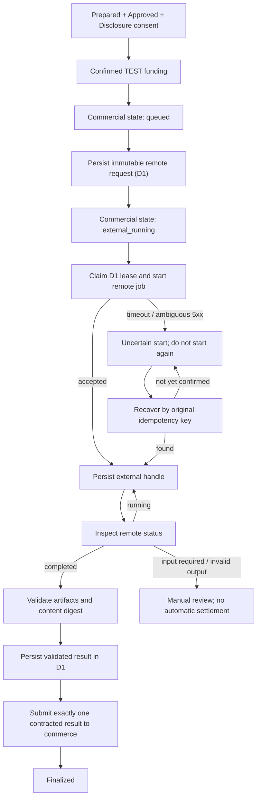

# Trusted remote dispatch bridge (draft v0.1)

**Operational status:** sandbox-only. This is a real, testable, asynchronous, signed HTTP bridge from a separately human-approved, test-funded WorkOrder to a pinned remote executor, **not** authorization to deploy arbitrary external agents or to spend real money.

The intended commercial pipeline is `catalog.search -> quotes.request -> work.prepare -> separate human quote approval -> separate human outside-data consent -> confirmed TEST funding -> work.start -> Queue -> trusted dispatch -> remote WorkExecutor -> validated result -> submitted`.

## The four separate contracts

1. **TaskType / Offering**: the semantic work and vendor commitment, versioned in the broker's trusted catalog. Listings discovered through Bazaar/Poppy/MCP are candidates, not authoritative routing instructions.
2. **WorkOrder / Quote**: buyer-specific, immutable scope, price, offering version, and prepared-input commitment. Human approval attaches to its exact quote digest.
3. **External disclosure grant**: independent human authorization binding work ID, input digest, data classification, external executor HTTPS origin and ID, task and offering, and allowed effects. The grant is held by the broker; it is not signed by a model or obtained from the remote provider.
4. **ExecutionRequest**: generated by the trusted broker from the WorkOrder and a pinned registry mapping, using a stable `executionId`, `idempotencyKey`, contract digest, explicit input types and narrow executor constraints. Neither Stripe payment credentials nor user OAuth secrets cross into the executor.

### Currently hard-pinned sandbox mapping

| Field | Value |
|---|---|
| Offering ID / version | `offering:modbus-report` / `1` (fictional) |
| TaskType | `task:modbus-diagnostics` |
| Price ceiling | USD 35.00 (3500 minor units) |
| Input disclosure | explicitly **public** small inline strings; no artifact URLs |
| Permitted effects | none; read-only |
| Required output | validated inline `application/json` |
| Executor | administrator-configured ID, host, HTTPS origin and shared signing key |
| Funding | only `sandbox` or Stripe **TEST**, not production money |
| Executor behavior | **synthetic**, not a real Modbus diagnostic |

The buyer agent must request `work.prepare` with `dataClassification:"public"` for this specific example; default remains `internal` and the bridge fails closed. Both quote and input commitments are independently recomputed before dispatch. The separate human review displays the external destination and requires a conscious disclosure decision. The human credentials remain outside the MCP client.

## Execution state model



The adapter reports `outcome_unknown` when a remote POST may have been accepted. In that state the broker **only calls recovery**, never blindly repeats the POST. The external service must durably index the original idempotency key.

The D1 store uses optimistic compare-and-swap version checks plus a short lease. The first successful POST is preceded by a persisted `starting` record, so even an unobserved Worker crash leaves enough information to reconcile. The bridge persists the result before transitioning the commercial state to `submitted`, so a crash between those actions can safely retry finalization without a second remote execution.

Cloudflare Queues uses at-least-once delivery and explicit per-message `ack()`; its scheduled recovery scan re-enqueues queued and due remote jobs. Multiple Queue messages don't constitute additional authorization. D1 optimistic concurrency prevents two workers from both claiming the same version, although stale in-flight effects must still be reconciled at the remote provider. Details: https://developers.cloudflare.com/queues/configuration/batching-retries/ and https://developers.cloudflare.com/d1/worker-api/d1-database/.

**Current limitation:** the cron runs every five minutes, so nonterminal remote executions may be polled only at that cadence, not continuously. There is no push-subscription or MCP Tasks projection yet. Long-running executor job heartbeat and remote capacity policies are separate follow-ups.

## Local setup

Prerequisites: Node 24+, pnpm 10, a Cloudflare account with an eligible D1 database and Queue, and the existing AWC sandbox configured as in `docs/contract-execution.md`.

1. Deploy or locally run `examples/remote-executor` and its D1 database. Apply `0001_executions.sql`; set `ENABLE_EXAMPLE_EXECUTOR=true` and a unique 32+-character `AWC_SHARED_KEY`. The example serves `/.well-known/awc-adapter.json`, `/v1/executions`, handle status and recovery routes. The output is deterministic sample JSON.
2. In the marketplace Worker, apply `apps/server/migrations/0004_dispatch.sql` in addition to previous migrations. Configure the Queue and its scheduled recovery, as already documented.
3. Add these **operator-controlled**, secret-backed settings to the broker Worker:
   ```dotenv
   ENABLE_TRUSTED_REMOTE_DISPATCH=true
   AWC_REMOTE_EXECUTOR_ID=awc.example.remote-executor
   AWC_REMOTE_EXECUTOR_ORIGIN=https://executor.your-approved-domain.example/
   AWC_REMOTE_EXECUTOR_HOST=executor.your-approved-domain.example
   AWC_REMOTE_EXECUTOR_SHARED_KEY=<same unique shared key set on remote Worker>
   ```
   The domain above is a placeholder; replace it with a real approved HTTPS host. Do not take the remote URL from a buyer or provider prompt. `AWC_REMOTE_EXECUTOR_SHARED_KEY` belongs in Worker secrets.
4. Keep Stripe in TEST mode or use local-only `ENABLE_LOCAL_SANDBOX=true` with distinct 32+ character human and agent tokens. **Do not configure production payment keys or real work.**
5. Using an authorized MCP buyer, obtain a quote for `offering:modbus-report` and prepare public sample work:
   ```json
   {
     "quoteId": "quote_...",
     "dataClassification": "public",
     "idempotencyKey": "demo_remote_001",
     "inputs": [{
       "name": "observations",
       "mediaType": "text/plain",
       "kind": "inline",
       "data": "PUBLIC SYNTHETIC DATA: 100ms Modbus poll timeout"
     }]
   }
   ```
6. In the separate human review page, approve the exact commercial terms, then review the pinned external origin and explicitly authorize disclosure. Complete Stripe TEST Checkout or local synthetic funding.
7. The buying agent calls `work.start`. Queue dispatch sends the signed `awc.execution/v1` request. `work.get` returns commercial status plus a sanitized remote status (executor ID, handle, digest, error), while the full WorkResult is only submitted after validation.

### CI verification

Run:
```sh
pnpm install --no-frozen-lockfile
pnpm --filter @awc/mcp-ui build
pnpm typecheck
pnpm test
pnpm --filter @awc/server bundle
pnpm --filter @awc/example-remote-executor bundle
```

The dispatch suite covers: refusal before funding/consent, binding of offering/quote/data classification, ambiguous accepted POST with recovery rather than a second start, invalid output MIME, single execution and idempotent finalization. A second suite calls the **actual remote Worker HTTP handler** through the signed remote adapter, including a deliberately lost POST response after the remote D1 write.

## Trust and release limitations

- The remote executor's HMAC proves possession of an administrator-provisioned integration key and exact request bytes. It does **not** prove task quality, an independently verified provider identity, or authorization to access external customer systems.
- `grantRef` is a broker reference, **not a bearer capability**. No external permissions or paid subcontracting are delegated.
- D1 stores the exact bounded, explicitly public input strings and result payloads. A production version needs R2 artifact encryption, retention/deletion policies, PII controls, tenant ACLs and provenance-signing.
- The bridge **does not** connect GitHub opportunities to commercial WorkOrders automatically and never accepts remote-discovered prices as binding quotes.
- Marketplace provider onboarding, paid settlement, Stripe refunds/chargeback monitoring, x402 Gateway, real worker authentication upgrades, rate limits, capacity routing and independent Attest validation are not completed here.
- The initial test executor has no real assessment logic. A successful synthetic artifact is not a verified professional outcome.
- Future production dispatch must support explicit signed grants, cost accounting across subcontractors, cancellation/revision, human input requests, external side-effect policy, quality assessment and independent Attest receipts.

Use `@awc/dispatch` as the trusted adapter bridge; keep `@awc/runtime`'s older synchronous worker interface for compatibility until the new execution protocol has a production replacement.
