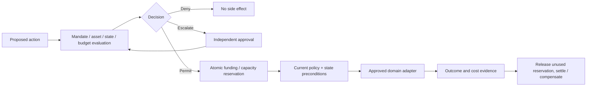

# AWC Responsibility and Operating Mandates — Draft v0.1

**Status:** Experimental proposal. Not an authorization standard approved by an SDO, a legal contract template, a payment scheme, or permission to operate physical equipment.

This profile describes how a principal may delegate bounded economic and operational responsibility to an agent or service operator while retaining oversight and accountability. It extends the commercial `WorkOrder` model; it does not alter Poppy, OAuth, x402, MCP or A2A wire protocols.

## 1. Terms and trust boundaries

- **Principal:** an organization or person legally responsible for the relevant account or duty, not necessarily the asset owner.
- **Accountable party:** the legal/contracting party that remains answerable for fulfillment, safety and compliance; software is not automatically a legal person.
- **Delegate:** an actor assigned operational decisions within a mandate.
- **OperatingMandate:** immutable versioned authority and obligations associated with an ongoing managed operation. Revocation lives in independently authoritative state.
- **Obligation:** one declared metric/process/prohibition with authoritative measurement source. A target does *not* grant additional action authority.
- **ActionProposal:** a specific, versioned intent evaluated against the current state, obligations, resource-owner permission, and spending limits.
- **Asset-owner permission:** independent right to change or access the resource. A contractor's own mandate cannot grant rights to another party's machine or account.
- **EconomicAccount:** simulated in v0.1. Its actual funding source, commitments, reservations and liabilities remain different from contractual revenue.
- **ActionReceipt:** attributable observation of attempted/completed action with agreement, authority, effects and evidence references. A *simulation receipt* is not a signed Attest or financial receipt.

## 2. Non-negotiable rules

1. A mandate MUST name principal, delegate, accountable party, operation, entities, permitted actions, denied actions, effective dates, and financial-account constraints.
2. Delegating a mandate MUST produce a strict attenuation of permissions, maximum risk, data classification, geography/entity scope, time, delegation depth, and per-action budget. The child MUST be issued by the parent delegate and retain principal/accountable-party identity.
3. **Parallel descendant allowances MUST share one budget**. Granting two child allowances cannot multiply the original parent economic ceiling.
4. The ability to spend is separate from actual funds. An authorized budget never guarantees available cash or credit; financial reservation MUST check both.
5. A contractor's operating mandate MUST NOT imply asset-owner permission or override independent site policy.
6. Operational change requires a current versioned observation. Stale telemetry, missing observation or unknown state MUST fail closed.
7. Raw actuator/PLC writes, safety-function changes and safety-critical actions MUST NOT be executed through the generic AWC operating adapter. Physical/OT capabilities require separate site-specific engineering, certified safety controls and appropriately authorized personnel; this reference implementation forbids them entirely.
8. If independent approval is required, a model assertion or agent-authenticated MCP call MUST NOT create that approval. The trusted approval system must bind an authenticated approver to the exact proposal revision, entity and time.
9. The final action gateway MUST re-evaluate authority, asset state, effects and financial reservations immediately before performing the side effect. A cached planning decision is advisory.
10. For an external action, an acknowledgement is not automatically proof of successful completion or payment settlement; record uncertainty and reconcile by provider idempotency keys and authoritative status.
11. Revocation prevents new authority, not retroactive erasure of liabilities or completed physical actions. Wind-down requires independent safety and operator continuity.
12. A verified signature proves issuer attribution, not objective truth, professional competence or legal transfer of liability.

## 3. Normative object model (v0.1 reference implementation)

- `OperatingMandate`: `schemaVersion`, IDs, parent, agreementRef, issued/valid/expires, `scope`, `economics`, `obligations`.
- `scope`: exact `entityIds`, `actions`, `deniedActions`, `approvalActions`, `maximumRisk`, `maximumDataClassification`, `maximumObservationAgeMs`, `remainingDelegations`.
- `economics`: `accountId`, ISO-like currency code, nonnegative integer **minor units**, maximum total exposure and maximum single commitment.
- `ActionProposal`: exact actor, delegate mandate, operation/entity, semantic action, risk class, data classification, effects, expected state version, revision digest, and optional quantified financial commitment.
- `OwnerPermission`: resource, principal grantee, permitted action and validity (trusted system input, not a model claim).
- `PolicyDecision`: `permit`, `permit-with-conditions`, `escalate`, or `deny`, with stable reasons and mandate ancestry.

Reference schemas are implemented in TypeScript/Effect in `packages/responsibility/src/index.ts`. The v0.1 JSON representation is illustrative and MUST NOT be passed as a token or signing format until a canonical encoding/signature profile is reviewed.

### Logical authorization predicate

```text
Permitted =
  ValidMandateChain && ValidCurrentActor && AllowedScope
  && AssetOwnerPermission && Site/ContractPolicy
  && FreshEntityState && (ApprovalNotNeeded || IndependentApproval)
  && (NoFinancialCommitment || (BoundedAuthority && FundedReservation))
  && NotSafetyCriticalRawControl
```

No single document (including this mandate) is all those authorities.

### Attenuation

Effective child permissions are the intersection of all ancestor mandates plus independent asset-owner and domain rules. The parent retains a single economic budget; children must reserve mutually exclusive allowances from that budget. The parent cannot spend allowance already delegated to a child. Reuse and revocation policies must handle outstanding reservations rather than deleting history.

### Continuous obligations

Obligations are observed over stated metrics, windows and authoritative sources. Missing or stale telemetry yields `unknown`, not `met`. A breached objective does not enlarge the set of allowed actions.

## 4. Economic ledger invariants

For account `A`:

```text
available(A) = funded(A) - captured(A) - reserved(A)
available(A) >= 0
```

For mandate `M`:

```text
unallocated(M) = ceiling(M) - captured(M) - reserved(M) - childAllowances(M)
unallocated(M) >= 0
```

`reserveExpense` must atomically check idempotency, per-action maximum, the mandate's unallocated allowance, ancestor revocation, and actual available account funds. `captureExpense` converts the reservation into an irreversible recorded charge up to the reserved amount; `releaseExpense` returns only unused authorization and funding. Refunds of captured funds require a separate trusted settlement/credit event, never an arbitrary balance mutation.

The current `@awc/economics` implementation enforces these rules **in memory only**. It does not move real money. A production ledger must provide serializable transactions across accounts and mandate ancestors, durable outbox, idempotent reconciliation, expirations, chargebacks and immutable events.

## 5. Action protocol and operations



Actions and receipts refer to immutable proposal IDs and revisions. Execution may generate bounded AWC WorkOrders. MCP Tasks and A2A Tasks remain protocol execution handles, not substitutes for authority or commercial commitments.

## 6. Resource vs operational actions

Resources include machines, inventory, cloud capacity, storage, suppliers and personnel. Operations include business planning, dispatch, maintenance coordination and permitted supervisory workflows.

Recommended risk classes:
- `observe`: authorized read.
- `plan`: prepare a proposal with no external commitment.
- `commercial`: create cost or legal commitment; requires explicit quantified worst-case exposure and trusted funding.
- `operational`: schedule, book or coordinate an operational change; requires current state and site policy.
- `physical-control` and `safety-critical`: prohibited in reference adapter, no generic agent controls.

A physical domain adapter may later use OPC UA/ISA-95 or W3C WoT models for read-only semantic discovery, but discovering a method is NOT permission to invoke it.

## 7. Worked cross-industry examples

- **Vending:** `inventory.replenishment.request` raises a synthetic restock work request; it does not dispense goods or change refrigeration controls. Requires independent machine owner's permission, internal funding and stock observation.
- **Cloud:** `capacity.acquire` authorizes a synthetic capacity allocation. Real provider credentials and provisioners are not involved.
- **Production cell:** `maintenance.ticket.create` can prepare approved coordination work; `production.schedule.propose` escalates for independent review; `plc.write_coil` is denied regardless of the agent objective.

Run using `pnpm operations:demo` or MCP `operations.simulate`. No live assets, credentials, cloud resources, payment rails, or signed Attest receipts are involved.

## 8. Conformance checklist

- [x] Schema validates delegated identity, time, limits and attenuation, rejects absent/cyclic parents.
- [x] Asset-owner authorization independent from economic principal.
- [x] Current-state and stale-observation safeguards, explicit approvals by trusted issuer context.
- [x] Block raw PLC/actuator and safety-critical actions by default.
- [x] Shared parent budget across sibling mandates; funded ledger separate from permission.
- [x] Atomic in-memory idempotent expense reservation/capture/release; revoked parent denies descendant spending.
- [x] Same controller across vending, cloud and production-cell synthetic adapters.
- [x] Explicit `unknown` on absent objective evidence, not automatic compliance.
- [x] MCP public simulation tool with no live ability to issue authorities or execute.
- [ ] Durable multi-party signed mandate issuance, cryptographic verification, issuer revocation service, holder binding.
- [ ] Real financial ledger and merchant integration with independent funding settlement.
- [ ] Domain-specific safety review and plant control integration (out of v0.1 reference scope).
- [ ] Independent evidence signing and verification with `gmackie/attest`.

## 9. Interoperability references

- OAuth Token Exchange (RFC 8693): https://www.rfc-editor.org/rfc/rfc8693.html
- OAuth Rich Authorization Requests (RFC 9396): https://www.rfc-editor.org/rfc/rfc9396.html
- W3C WoT Thing Description 1.1: https://www.w3.org/TR/wot-thing-description11/
- ISA-95 / IEC 62264 and ISA/IEC 62443: established manufacturing operations and industrial cybersecurity frameworks.
- NIST SP 800-82 Rev. 3: https://csrc.nist.gov/pubs/sp/800/82/r3/final
- Attest Issue #9 (verifiable marketplace work receipts): https://github.com/gmackie/attest/issues/9

Do not claim formal conformance to those external standards based on the reference adapter alone.
